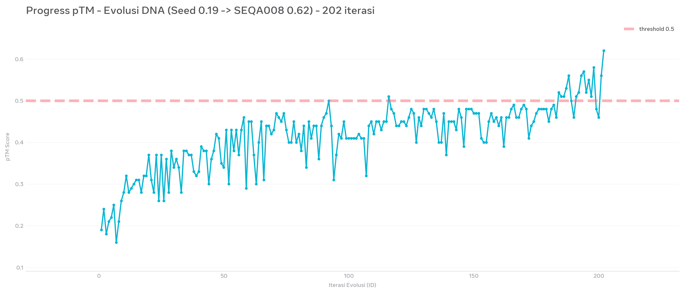
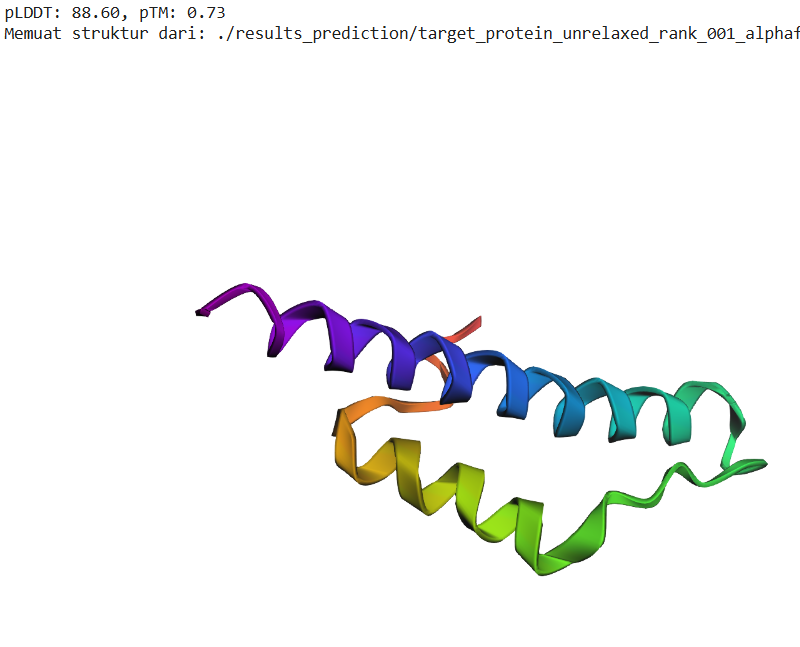
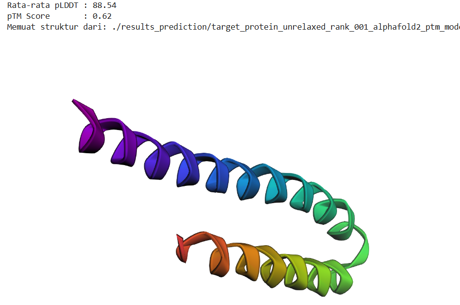

# Eksperimen Sekuens Protein Berbasis Ideomotor

## Gambaran Umum

Repositori ini mendokumentasikan eksperimen eksploratif yang melibatkan pembuatan sekuens melalui proses ideomotor, penerjemahan sekuens nukleotida menjadi protein, serta prediksi struktur protein menggunakan perangkat komputasi.

Eksperimen ini bertujuan mencatat proses dan hasil pengamatan yang dapat ditinjau lebih lanjut. Pendekatan yang digunakan belum divalidasi sebagai metode desain protein dan tidak diklaim memiliki keunggulan dibandingkan metode yang sudah ada.

## Data dan Berkas

| Berkas atau direktori    | Keterangan                                                 |
| ------------------------ | ---------------------------------------------------------- |
| `sequence.dna.002.txt` | Berkas sekuens nukleotida yang digunakan dalam eksperimen. |
| `protein.png`          | Visualisasi struktur protein hasil prediksi.               |
| `image/readme/`        | Gambar pendukung dokumentasi eksperimen.                   |
| `image/dataset1/`      | Rangkaian eksperimen 1                   |
| `image/dataset2/`      | Rangkaian eksperimen 2                   |
| `readme.md`            | Dokumentasi eksperimen.                                    |

## Alur Eksperimen

Secara umum, proses yang didokumentasikan meliputi:

1. Pembuatan sekuens melalui proses ideomotor.
2. Penerjemahan sekuens nukleotida menjadi sekuens asam amino, sesuai kerangka pembacaan dan kode genetik yang digunakan.
3. Prediksi struktur protein menggunakan perangkat komputasi.
4. Pencatatan metrik dan visualisasi hasil prediksi.
5. Evaluasi awal terhadap hasil untuk menentukan kemungkinan penelitian lanjutan.

Tahapan tersebut merupakan gambaran umum eksperimen. Rincian prosedur, parameter, dan perangkat lunak perlu didokumentasikan secara terpisah agar hasilnya dapat direproduksi.

## Hasil Prediksi yang Dilaporkan

Dokumentasi awal mencantumkan nilai berikut:

Dataset 1:

| Metrik                                                     | Nilai yang dilaporkan |
| ---------------------------------------------------------- | --------------------: |
| Predicted TM-score (pTM)                                   |                  0,62 |
| Rata-rata predicted Local Distance Difference Test (pLDDT) |                 88,54 |
| Jumlah Percobaan                                           |                  ~202 |

Dataset 2 :

| Metrik                                                     | Nilai yang dilaporkan |
| ---------------------------------------------------------- | --------------------: |
| Predicted TM-score (pTM)                                   |                  0,73 |
| Rata-rata predicted Local Distance Difference Test (pLDDT) |                 88,60 |
| Jumlah Percobaan                                           |                  ~202 |

Nilai tersebut dicantumkan sebagai hasil prediksi komputasional yang dilaporkan, bukan sebagai hasil pengukuran eksperimental.

pTM memberikan indikasi kepercayaan model terhadap topologi struktur yang diprediksi, sedangkan pLDDT menggambarkan kepercayaan lokal terhadap struktur pada tingkat residu.

Kedua metrik tersebut tidak dengan sendirinya membuktikan bahwa protein memiliki kestabilan fisik, aktivitas biologis, atau fungsi tertentu dalam kondisi nyata.

Interpretasi hasil perlu mempertimbangkan sekuens masukan, perangkat lunak, konfigurasi prediksi, dan informasi pendukung lainnya.

## Visualisasi Struktur Protein

Berkas berikut dipertahankan sebagai bagian dari dokumentasi visual eksperimen.

Gambar tersebut merupakan visualisasi hasil prediksi struktur protein. Bentuk yang terlihat tidak boleh langsung ditafsirkan sebagai bukti kestabilan atau fungsi biologis protein.

Gambar pendukung lain yang tersimpan di direktori `image/readme/` juga merupakan bagian dari dokumentasi dan tetap dipertahankan.

## Keterbatasan

Eksperimen ini memiliki beberapa keterbatasan:

* Proses pembuatan sekuens masih bersifat eksploratif.
* Reproduksibilitas proses belum ditetapkan.
* Satu hasil prediksi belum cukup untuk menyimpulkan efektivitas suatu metode.
* Metrik prediksi struktur bukan pengganti validasi eksperimental.
* Belum tersedia dasar yang cukup untuk menyatakan bahwa pendekatan ini lebih unggul daripada metode pembanding.
* Kesimpulan yang lebih kuat memerlukan prosedur terdokumentasi, pengulangan eksperimen, pembanding yang sesuai, dan analisis tambahan.

## Pengembangan Selanjutnya

Beberapa kemungkinan pengembangan meliputi:

* Mendokumentasikan sekuens nukleotida dan protein secara lengkap.
* Mencatat versi perangkat lunak, konfigurasi model, dan parameter prediksi.
* Menyimpan hasil prediksi serta data pendukung dalam format yang dapat diperiksa.
* Mengulangi eksperimen dengan prosedur yang terdokumentasi.
* Membandingkan hasil dengan sekuens kontrol dan metode pembanding yang sesuai.
* Menguji apakah data eksperimen dapat dimanfaatkan untuk analisis atau pelatihan model *machine learning*.
* Melakukan validasi eksperimental apabila diperlukan dan memungkinkan.

## Lisensi dan Penggunaan Data

Dokumentasi dan materi orisinal dalam repositori ini ditujukan untuk penggunaan terbuka dalam penelitian, analisis, dan pengembangan teknologi.

Materi yang haknya dimiliki atau dapat dilisensikan oleh pembuat repositori dapat digunakan berdasarkan lisensi **Creative Commons Attribution 4.0 International (CC BY 4.0)** setelah lisensi tersebut secara resmi diterapkan.

Penggunaan yang diperbolehkan berdasarkan lisensi mencakup penyalinan, distribusi, adaptasi, dan pemanfaatan materi untuk pengembangan serta pelatihan model *machine learning*, termasuk untuk tujuan komersial, dengan memenuhi ketentuan atribusi.

Lisensi tidak otomatis mencakup materi pihak ketiga yang mungkin memiliki ketentuan penggunaan tersendiri. Pengguna bertanggung jawab memeriksa hak dan ketentuan yang berlaku atas setiap materi yang digunakan.

Teks lengkap lisensi: https://creativecommons.org/licenses/by/4.0/

## Tujuan Repositori

Repositori ini merupakan catatan terbuka atas eksperimen komputasi biologi yang masih bersifat eksploratif.

Tujuannya adalah mendokumentasikan data, menyimpan visualisasi, mencatat hasil pengamatan, dan memungkinkan pihak lain meninjau maupun mengembangkan penelitian lebih lanjut.

Hasil yang tersedia sebaiknya diperlakukan sebagai pengamatan awal untuk pengujian hipotesis, bukan sebagai bukti bahwa metode desain protein tertentu telah terbukti efektif.
